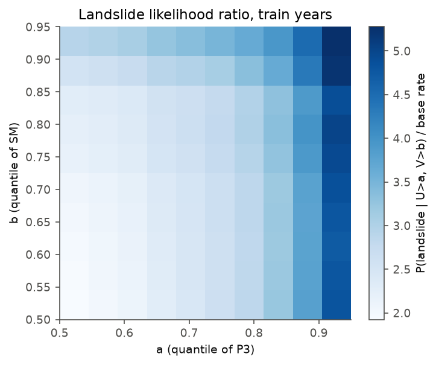

# Compound rainfall and soil-moisture drivers of landslides in Nepal

Does knowing how wet the ground already is (antecedent soil moisture) help tell landslide
days apart from ordinary monsoon days, once rainfall is known? And how often do extreme
rainfall and wet soil occur together?

## Approach

I match reported landslides (BIPAD, Government of Nepal, with NASA COOLR as a check) to
district-daily rainfall (GPM IMERG) and root-zone soil moisture from the day before
(ERA5-Land), for the June to September monsoons of 2011-2025. The analysis then:

1. converts each variable to a rank within its district, which removes differences in
   climate between districts,
2. fits extreme-value marginals (GPD, with threshold diagnostics),
3. fits and tests bivariate copulas (Gaussian, t, Clayton, Gumbel, Frank, Joe), compared by
   AIC and a parametric-bootstrap Cramér-von Mises test, and compares tail dependence,
4. computes AND, OR and Kendall return periods (Salvadori, De Michele & Durante 2011) for
   every reported landslide day,
5. estimates P(landslide | rainfall, soil moisture) on a grid, and
6. scores warning rules on held-out years (2021-2025): the Dahal & Hasegawa (2008) rainfall
   threshold, a rainfall-only rule, a joint rainfall-and-soil rule and a logistic model,
   with uncertainty from resampling whole years.

> Status: v0.1, first run on real data (27 Sep 2026). The results below come from the
> downloads described in `data/README.md` and are preliminary. The copula section still
> needs a better-fitting family and a goodness-of-fit test that allows for dependence
> between days. The pipeline is also tested end to end on synthetic data with a known
> answer (`tests/test_pipeline.py`).

## Key result

**Antecedent soil moisture did not help.** Adding ERA5-Land soil moisture to 3-day IMERG
rainfall left the test-year AUC at 0.716 (2021-2025; gain +0.000, 90% year-bootstrap
interval −0.007 to +0.006). I re-ran the analysis with a different rainfall product, other
rainfall windows, surface instead of root-zone soil moisture, a two-day lag, and NASA COOLR
labels. With 3-day rainfall, no variant gained more than 0.006 AUC. That largest gain came
from surface (0-7 cm) soil moisture, and about half of it disappears when soil moisture is
taken two days back instead of one. ERA5-Land days run on UTC, so "the day before" overlaps
the first 5 h 45 min of the landslide day in Nepal time. Early rain on the landslide day
leaking into the soil-moisture value is the likely explanation.



In the training years, wet soil does raise the landslide rate when 3-day rainfall is in its
top 10%: 4.3 times the base rate with wet soil, against 2.4 times with dry soil. But the
figure changes mostly from left to right, with rainfall. The 3-day total already contains
most of what soil moisture adds. All variants are in `results/robustness/summary.md`. The
headline is the analysis fixed in advance: root-zone soil moisture at t−1.

These are reported landslide days (BIPAD), and reporting grows 4-8 times over the period, so
the test-year base rate is 2.3 times the training-year rate. Computing AUC within each test
year removes that difference and gives the same answer. The results are associations, not
causes.

## Reproduce

```bash
conda env create -f environment.yml && conda activate nepal-compound
# or: pip install -r requirements.txt

python scripts/01_download_boundaries.py          # 77 districts (OCHA COD-AB, HDX)
python scripts/02_download_bipad.py               # BIPAD landslide incidents
python scripts/03_download_coolr.py               # NASA COOLR (independent check)

earthengine authenticate                          # once
python scripts/04_download_forcing_gee.py --project YOUR_GCP_PROJECT --product era5l
python scripts/04_download_forcing_gee.py --project YOUR_GCP_PROJECT --product imerg
python scripts/04_download_forcing_gee.py --project YOUR_GCP_PROJECT --product chirps   # optional

python scripts/05_build_table.py
python scripts/06_run_analysis.py
python scripts/07_robustness.py                   # variants -> results/robustness/summary.md
pytest -q                                         # unit + end-to-end tests
```

Every setting (period, season, train/test years, windows, copula families) is in
`config/study.yaml`.

## Outputs

| File | What it shows |
|---|---|
| `figures/fig01_reporting.png` | Reported landslide days per year and month (reporting-bias check) |
| `figures/fig02_dependence.png` | Rank scatter with landslide days; empirical vs copula tail dependence |
| `figures/fig03_marginals.png` | Mean residual life, GPD shape stability, return levels |
| `figures/fig04_copula_aic.png` | Copula family comparison |
| `figures/fig05_conditional_probability.png` | Landslide likelihood ratio given rainfall and soil quantiles |
| `figures/fig06_return_periods.png` | AND, OR and Kendall vs rainfall-only return periods of landslide days |
| `figures/fig07_skill.png` | Out-of-sample skill (true skill statistic) of each warning rule |
| `results/summary.md`, `summary.json` | All numbers behind the figures |
| `results/landslide_day_return_periods.csv` | Return periods for every landslide day, sorted by deaths |
| `results/robustness/summary.md` | Headline numbers for each robustness variant |
| `data/events/cascades.csv` | Curated table of five Nepal cascade events (case studies only) |

## Design choices

Soil moisture is taken from the day before (t−1). ERA5-Land soil moisture responds to
rainfall, so same-day values would count the same storm twice.

IMERG is summed over Nepal calendar days (00:00 to 24:00 local time) to match BIPAD dates.
ERA5-Land daily values are UTC days, which run from 05:45 to 05:45 local time. This small
misalignment is why the robustness runs include a two-day lag.

Rank transforms, thresholds and model coefficients are fitted on 2011-2020 only and applied
unchanged to 2021-2025.

The units are districts. They are coarse, but incidents are reported by district.
Catchments are a planned extension.

## Limitations (read before citing)

- BIPAD records reported landslides that caused damage, mostly near roads and settlements,
  and reporting effort changes over time (see fig01). The results describe reported
  landslide days.
- Gridded rainfall underestimates orographic extremes in the Himalaya. The Dahal-Hasegawa
  threshold was derived from gauges, so the comparison here is only about relative skill.
- Daily values are serially dependent, so the return periods are indicative hazard levels,
  not exact recurrence intervals.
- The results are associations, not causation.
- Cascade events (landslide dams, outburst floods) are far too rare for statistics. They are
  documented in `data/events/` as case studies only.

## Data sources and licences

| Data | Source | Licence / terms |
|---|---|---|
| Landslide incidents | BIPAD portal, NDRRMA, Government of Nepal (bipadportal.gov.np) | Public portal; cite NDRRMA |
| Landslide reports | NASA COOLR / Global Landslide Catalog (Kirschbaum et al. 2010, 2015; Juang et al. 2019) | Open; cite per record |
| Rainfall | GPM IMERG V07 (NASA), via Google Earth Engine | Open (NASA) |
| Rainfall, soil moisture | ERA5-Land daily aggregates (Muñoz-Sabater et al. 2021), via Earth Engine | Copernicus licence (CC BY 4.0) |
| Rainfall (check) | CHIRPS v2 (Funk et al. 2015) | CC BY 4.0 / public domain |
| District boundaries | OCHA COD-AB Nepal ADM2 v02 (Survey Department of Nepal), via HDX | CC BY-IGO |

Raw downloads are not redistributed. The scripts recreate them.

## References

- Dahal, R.K. & Hasegawa, S. (2008). Representative rainfall thresholds for landslides in the Nepal Himalaya. *Geomorphology* 100, 429–443.
- Salvadori, G., De Michele, C. & Durante, F. (2011). On the return period and design in a multivariate framework. *HESS* 15, 3293–3305.
- Genest, C. & Favre, A.-C. (2007). Everything you always wanted to know about copula modeling but were afraid to ask. *J. Hydrol. Eng.* 12, 347–368.
- Zscheischler, J. et al. (2020). A typology of compound weather and climate events. *Nat. Rev. Earth Environ.* 1, 333–347.
- Banfi, F. et al. (2024). Temporal clustering of precipitation for detection of potential landslides. *NHESS* 24, 2689–2704.
- Coles, S. (2001). *An Introduction to Statistical Modeling of Extreme Values.* Springer.

## Author

Milan Samal. Code MIT licence; text and curated tables CC BY 4.0.
